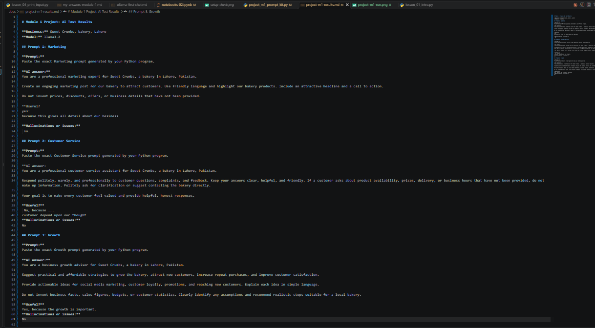

Name: Shamas Ali Goraya
Course: AI For Everyone
AI Goal:
"To became a Associate AI Engineer"
Who to run:
uv run main.py
List of lession don so far:
1- creat folder(code) and in two file lession-01, 02
2- creat (docs) folder and in which two file ollama-first-chat , setup-check..
3- creat folder (notebooks) in which two file 01,02
erase src. folder
erase few line in toml
wrok on main.py
wrok on readme.md folder


## Module 1 Project: AI Prompt Kit

A Python tool that turns a local business's details into
3 ready-to-use AI prompts for marketing, customer service,
and business growth.

### Run

```bash
uv run code/project_m1_prompt_kit.py
```

### Screenshot



### Who would pay for this?

Small business owners who want to use AI for marketing,
customer service, and growth but do not know how to write
effective prompts.


## Task 1.8: Business Helper Bot — Intent Design

Business: Bright Future Tuition Centre

| Intent | What the user wants | Keywords | Bot reply |
|---|---|---|---|
| Greeting | Start a conversation | hi, hello, hey | Greet the customer by name |
| Courses | Ask about subjects | course, subjects, teach | List example subjects |
| Timings | Ask about class times | timing, open, schedule | Share example timings |
| Fees | Ask about prices | fee, fees, cost | Explain that fees depend on the course |
| Location | Find the centre | location, address, where | Ask them to contact the centre |
| Complaint | Report a problem | complaint, problem, issue, late | Apologize and offer staff assistance |
| Human handover | Speak to a person | agent, human | Connect to a human |
| Fallback | Ask an unknown question | No matching keyword | Print a prompt for a future AI model |
| Goodbye | End the conversation | bye | Exit and print a summary |
